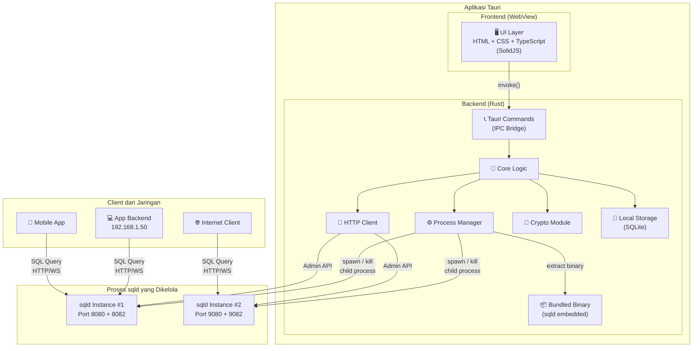

# 📋 Dokumen Requirement: Notane LibSQL Management

**Nama Proyek:** Notane LibSQL Management
**Versi Dokumen:** 3.0
**Tanggal:** 15 November 2026
**Teknologi Utama:** Rust (Backend) + Tauri + TypeScript (Frontend)
**Target Pengguna:** Developer & System Admin yang ingin menjalankan dan mengelola database libSQL di jaringan lokal maupun internet

---

## 1. Ringkasan Proyek

### 1.1 Apa Masalah yang Diselesaikan?

Saat ini, untuk menjalankan database **libSQL (Turso SQL)** secara self-hosted, developer harus:

1. ~~Install binary `sqld` secara manual~~ *(Tidak perlu lagi — di-bundle!)*
2. Menjalankan `sqld` dari terminal dengan banyak flag/parameter
3. Mengelola proses server secara manual (start/stop/restart dari terminal)
4. Menjalankan perintah `curl` secara manual ke Admin API untuk buat database
5. Generate key Ed25519 lewat terminal (`openssl`)
6. Membuat JWT token secara manual dengan script
7. Mengingat semua konfigurasi port, path, dan parameter

**Ini merepotkan dan rawan kesalahan**, terutama untuk tim yang mengelola banyak database.

### 1.2 Apa Solusinya?

Membangun **aplikasi desktop native** yang berfungsi ganda:

```
┌─────────────────────────────────────────────────────┐
│           Notane LibSQL Management                  │
│                                                     │
│  🖥️ SEBAGAI SERVER         🛠️ SEBAGAI MANAJEMEN    │
│  ─────────────────         ──────────────────────   │
│  • Bundle & jalankan sqld  • Buat/hapus database    │
│  • Start / Stop / Restart  • Generate JWT token     │
│  • Konfigurasi port & path • Kelola key pair        │
│  • Multi-instance          • Monitor & health check │
│  • Auto-restart on crash   • Activity log           │
│                                                     │
│  Komputer ini MENJADI server database libSQL        │
│  yang bisa diakses dari jaringan LAN/WAN/Internet   │
└─────────────────────────────────────────────────────┘
```

> [!IMPORTANT]
> Aplikasi ini memiliki **dua peran sekaligus**:
> 1. **Server** — menjalankan proses `sqld` (sudah di-bundle) di komputer lokal sehingga komputer tersebut menjadi database server
> 2. **Manajemen** — menyediakan GUI untuk mengelola database, token, dan konfigurasi tanpa perlu terminal
>
> **Analogi:** Seperti **XAMPP** untuk MySQL atau **Laragon** — kamu install satu aplikasi, klik tombol "Start", dan komputer kamu langsung jadi database server.

---

## 2. Arsitektur Tingkat Tinggi



---

## 3. Technology Stack

- **Backend:** Rust, Tauri v2, tokio, reqwest, rusqlite, ed25519-dalek, jsonwebtoken, aes-gcm, sha2
- **Frontend:** SolidJS, TypeScript, Tailwind CSS, Lucide icons, Vite
- **Binary Bundling:** `sqld` prebuilt binary extracted to local data directory on first launch

---

## 4. SQLite Schema (rusqlite)

```sql
CREATE TABLE IF NOT EXISTS instances (
    id TEXT PRIMARY KEY,
    name TEXT NOT NULL UNIQUE,
    http_listen_addr TEXT NOT NULL DEFAULT '0.0.0.0',
    http_port INTEGER NOT NULL DEFAULT 8080,
    admin_listen_addr TEXT NOT NULL DEFAULT '0.0.0.0',
    admin_port INTEGER NOT NULL DEFAULT 8082,
    data_dir TEXT NOT NULL,
    admin_auth_key TEXT,
    auto_start INTEGER NOT NULL DEFAULT 0,
    auto_restart INTEGER NOT NULL DEFAULT 1,
    created_at TEXT NOT NULL,
    updated_at TEXT NOT NULL
);

CREATE TABLE IF NOT EXISTS databases (
    id TEXT PRIMARY KEY,
    instance_id TEXT NOT NULL REFERENCES instances(id) ON DELETE CASCADE,
    name TEXT NOT NULL,
    jwt_public_key TEXT,
    jwt_private_key TEXT,
    created_at TEXT NOT NULL,
    UNIQUE(instance_id, name)
);

CREATE TABLE IF NOT EXISTS token_history (
    id TEXT PRIMARY KEY,
    database_id TEXT NOT NULL REFERENCES databases(id) ON DELETE CASCADE,
    label TEXT,
    permission TEXT NOT NULL CHECK(permission IN ('rw', 'ro')),
    issued_at TEXT NOT NULL,
    expires_at TEXT,
    created_at TEXT NOT NULL
);

CREATE TABLE IF NOT EXISTS app_config (
    key TEXT PRIMARY KEY,
    value TEXT NOT NULL
);
```
